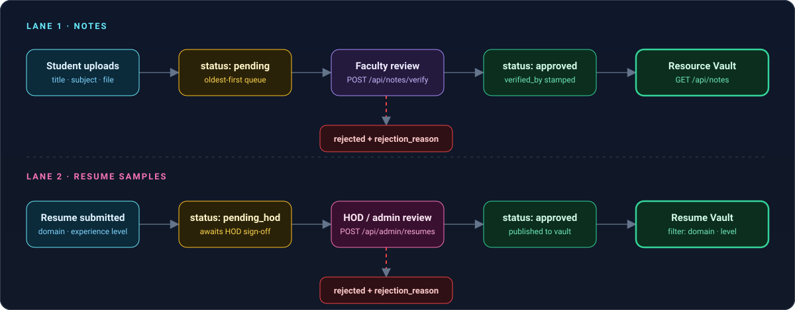
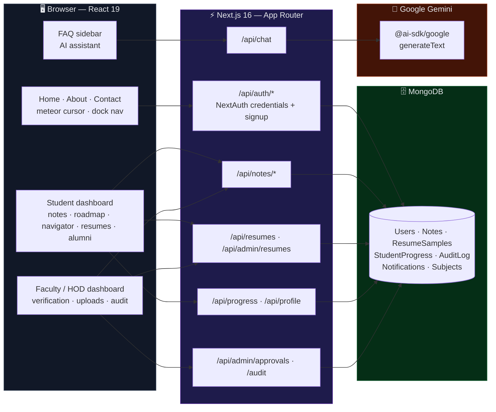
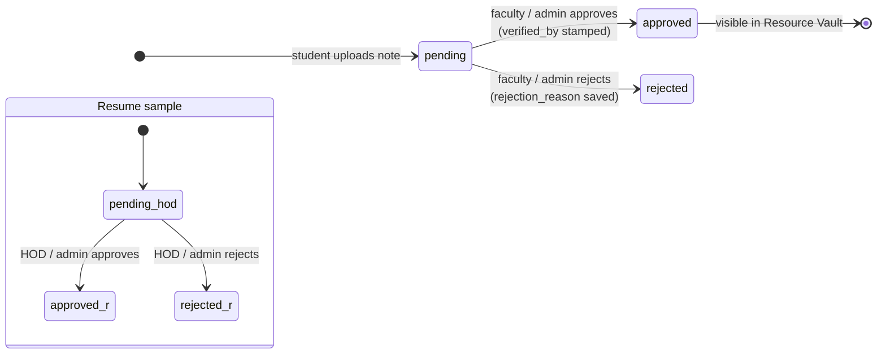
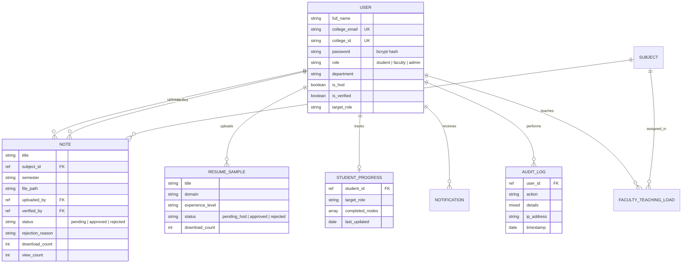

<div align="center">



<br/>

[](#-tech-stack)
[](#-tech-stack)
[](#-tech-stack)
[](#-data-model)
[-7c3aed?style=flat-square)](#-security--access-control)
[](#-ai-assistant)
[](#-tech-stack)
[](#-team)

**Verified notes. Visual roadmaps. Role-matched career guidance. One university, one portal, four roles — and a faculty approval gate on everything that gets published.**

</div>

---

## What is ARCADE?

ARCADE (**A**cademic **R**esource & **C**areer **A**ssist **D**igital **E**nvironment) is a **role-based university portal** that replaces the scattered mess of WhatsApp-forwarded PDFs, unverified study material, and "what should I even learn?" confusion with one governed system:

1. **Students upload notes; faculty verify them.** Nothing reaches the shared vault until a faculty member or admin approves it — with a recorded verifier and a rejection reason when it's declined.
2. **Learning is a roadmap, not a reading list.** Pick a target role and get a three-tier checklist (Mandatory → Advanced → Optional) that unlocks progressively as you tick skills off, with full-screen celebrations at each tier.
3. **A career-fit quiz maps your instincts to a domain.** The Skill Navigator scores your answers across five axes and explains *why* a domain fits you and what the market for it looks like.
4. **A vault of verified resume samples**, filterable by domain and experience level, published only after HOD/admin approval.
5. **An alumni & expert network** for mentorship contacts, plus an **AI assistant** that knows how the portal works.
6. **Every sensitive action leaves a trail.** Approvals, rejections, and batch print-and-clear actions are written to an audit log that admins can inspect.

It is built as a Semester 4 **Student Group Project** at CHARUSAT, scoped for **single-university use**: read-heavy, low write-frequency, and deliberately review-safe.

<br/>

<div align="center">

<sub>Animated in a browser (GitHub renders raw SVG natively) — packets show a submission moving through review into the vault, with the rejection branch below each lane.</sub>
</div>

---

## Table of Contents

- [Why This Exists](#why-this-exists)
- [Architecture at a Glance](#-architecture-at-a-glance)
- [Roles & Permissions](#-roles--permissions)
- [The Approval Workflow](#-the-approval-workflow)
- [Learning Roadmap Engine](#-learning-roadmap-engine)
- [Skill Navigator](#-skill-navigator)
- [Resume Vault & Alumni Network](#-resume-vault--alumni-network)
- [AI Assistant](#-ai-assistant)
- [Data Model](#-data-model)
- [API Surface](#-api-surface)
- [Security & Access Control](#-security--access-control)
- [Tech Stack](#-tech-stack)
- [Getting Started](#-getting-started)
- [Configuration Reference](#-configuration-reference)
- [Project Layout](#-project-layout)
- [Project Status](#-project-status)
- [Scope](#-scope)
- [Team](#-team)

---

## Why This Exists

University students lose time to four recurring problems, and ARCADE is built around fixing exactly those:

- **Scattered resources** — notes live across chat groups, drives, and personal laptops, with no single source of truth.
- **No verification** — a note being *available* says nothing about it being *correct*. ARCADE puts a faculty gate between upload and publish.
- **Unstructured preparation** — exam and placement prep happens without a map of what "ready" means for a given role.
- **Role confusion** — students often can't tell which skills a target career actually demands, or in what order to learn them.

The design answer is a **governed, role-aware system**: each role sees only what it should, each publish action has an accountable approver, and each learning path has an explicit order.

---

## 🏗 Architecture at a Glance

ARCADE is a single **Next.js App Router** application: the React UI and the REST-style route handlers ship together, talking to **MongoDB** through Mongoose.



**One deployable, one database.** There is no separate Express service — the API layer is the set of Next.js route handlers under `app/api/`, and Mongoose connections are cached across hot reloads and serverless invocations.

---

## 👥 Roles & Permissions

| Capability | 🎓 Student | 🧑‍🏫 Faculty | 🏛 HOD | 🛡 Admin |
|---|:---:|:---:|:---:|:---:|
| Browse approved notes & resume samples | ✅ | ✅ | ✅ | ✅ |
| Upload notes (enters **pending** queue) | ✅ | — | — | — |
| Upload notes directly | — | ✅ | ✅ | — |
| Approve / reject notes | ❌ | ✅ | ✅ | ✅ |
| Submit resume samples (enters **pending_hod**) | ✅ | ✅ | ✅ | — |
| Approve / reject resume samples | ❌ | HOD sign-off | ✅ | ✅ |
| Roadmap, Skill Navigator, alumni network | ✅ | — | — | — |
| Approve / reject new faculty & admin accounts | ❌ | ❌ | ❌ | ✅ |
| Read the audit log | ❌ | ❌ | ❌ | ✅ |

> **How HOD works:** HOD is not a separate login role — it is a **faculty account flagged `is_hod`** (designation *Head of Department*), which unlocks the resume-approval screen. Anyone can register as a student; **faculty and admin sign-ups require a verification code** (`ARCADE_ADMIN_SECRET`).

---

## 🔄 The Approval Workflow

Both content types follow the same pattern — *submit → pending → reviewed by a human → published or rejected with a reason* — and the review step always records **who** did it.



| Step | What happens | Where |
|---|---|---|
| **Queue** | Reviewers see pending notes **oldest first**, so the backlog clears in order | `GET /api/notes/pending` |
| **Decide** | Approve, or reject with a reason; the reviewer's ObjectId is stored as `verified_by` | `POST /api/notes/verify` |
| **Publish** | The public vault only ever returns `status: approved`, filterable by subject and semester | `GET /api/notes` |
| **Audit** | Account approvals and batch print-and-clear actions are appended to `AuditLog` | `POST /api/admin/approvals`, `POST /api/documents/print-and-clear` |

---

## 🗺 Learning Roadmap Engine

Pick a **target role** and ARCADE turns it into a tracked, tiered checklist. Progress is persisted per student (`completed_nodes`) so it survives across devices.

**Target roles:** Frontend Developer · Backend Developer · Full Stack Developer · Data Scientist · DevOps Engineer

```
┌──────────── Mandatory ────────────┐  ┌──────────── Advanced ─────────────┐  ┌──────────── Optional ─────────────┐
│ always open — the foundation set  │→ │ 🔒 locked until Mandatory is done │→ │ 🔒 locked until Advanced is done  │
└───────────────────────────────────┘  └───────────────────────────────────┘  └───────────────────────────────────┘
```

- **Progressive unlock** — locked tiers are blurred behind a lock indicator; a newly unlocked tier wears a **"NEW!!"** stamp until its first skill is ticked.
- **Three celebration variants** — completing a tier fires a full-screen confetti/fireworks overlay (*Foundation Set* → *Master Class* → *Completionist*) that briefly locks interaction so the moment lands.
- **Meaningful role changes** — switching target role is gated on learning outcomes (all mandatory skills plus at least two advanced ones), and profile edits are time-locked, to discourage random role-hopping.
- **Honest self-assessment** — the UI nudges students to tick only what they can genuinely do; the roadmap is a mirror, not a scoreboard.
- **Overview sync** — the dashboard Overview reads the same progress record, so the percentage you see on the home screen is the roadmap's real state.

---

## 🧭 Skill Navigator

A scenario-based quiz that scores every answer across **five domain axes** and returns the best match, with a written explanation for each part of the result.

| Axis | Domain it surfaces |
|---|---|
| `SYS` | Systems Architecture / Cloud Infrastructure |
| `OPS` | Product Operations & Logistics (ProductOps) |
| `QNT` | Quantitative Data Analysis |
| `PROD` | Consumer Product / UX Engineering |
| `RND` | Deep Tech / Applied R&D |

Each result is broken into **why you fit**, **how the role is changing**, **what automation means for it**, and **what the market looks like** — so the output is a conversation starter about careers, not just a label.

---

## 📄 Resume Vault & Alumni Network

- **Resume Vault** — approved sample resumes, filterable by `domain` and `experience_level` (`intern`, `fresher`, `experienced`, `advanced`). Each sample tracks a `download_count`, and the uploader's name is shown alongside it.
- **HOD approval screen** — a dedicated queue where the HOD reviews `pending_hod` submissions before anything is published.
- **Alumni & Expert Network** — a directory of alumni and industry experts with role, tags (e.g. *System Design*, *Cloud Architecture*), email and LinkedIn, so students know who to ask for what.

---

## 🤖 AI Assistant

A floating **FAQ sidebar** on the public pages talks to `POST /api/chat`, which calls **Google Gemini** through the **Vercel AI SDK** (`@ai-sdk/google` + `generateText`, 30-second max duration).

- The system prompt describes the platform role by role, so answers are about *this* portal, not generic.
- It is instructed to stay **concise** (2–3 sentences, short bullets, no headers) and to steer unrelated questions back to ARCADE.
- Replies are rendered with `react-markdown`.

---

## 🗄 Data Model



A few deliberate details: `personal_email` and `phone_number` use **sparse unique indexes** (so many users can leave them empty without tripping duplicate-key errors), and every model is registered with the `models.X || model(...)` guard so Next.js hot reloads don't recompile schemas.

---

## 🔌 API Surface

| Method | Route | Access | Purpose |
|---|---|---|---|
| `POST` | `/api/auth/signup` | Public (code for faculty/admin) | Create an account; bcrypt-hashes the password |
| `GET` `POST` | `/api/auth/[...nextauth]` | Public | NextAuth credentials sign-in, JWT session |
| `GET` | `/api/notes` | Public (approved only) | Approved notes; filter by `subject_id`, `semester` |
| `GET` | `/api/notes/pending` | Faculty / Admin | Pending queue, oldest first |
| `POST` | `/api/notes/verify` | Faculty / Admin | Approve or reject a note (with reason) |
| `GET` | `/api/resumes` | Public (approved only) | Approved resume samples; filter by `domain`, `experience` |
| `POST` | `/api/admin/resumes` | Faculty / Admin | Approve or reject a resume sample |
| `POST` | `/api/admin/approvals` | Admin | Approve or remove a pending account |
| `GET` | `/api/admin/audit` | Admin | Latest 50 audit entries |
| `GET` `POST` | `/api/progress` | Student | Read / upsert roadmap progress |
| `GET` | `/api/profile` | Signed-in | Current user's profile |
| `GET` | `/api/notifications` | Signed-in | The user's notifications |
| `GET` | `/api/user?role=` | Server lookup | List users by role (e.g. faculty for assignment) |
| `POST` | `/api/documents/print-and-clear` | Signed-in | Batch-increment download counts + audit entry |
| `POST` | `/api/chat` | Public | AI assistant (Gemini) |

---

## 🔐 Security & Access Control

- **Passwords** are hashed with **bcrypt** (10 salt rounds) before they touch the database.
- **Sessions** are **NextAuth JWTs** (30-day max age) carrying `id`, `role`, `college_id`, `department`, and `is_hod`.
- **Server-side role checks** — every privileged route calls `getServerSession` and rejects with `403` when the role doesn't match; the UI hiding a button is never the only line of defence.
- **Privileged sign-up is gated** — faculty and admin accounts need the shared verification code, and admin approval can verify or remove a pending account.
- **Accountability** — reviewer identity is stored on every approval, and admin actions are written to `AuditLog`.
- **Secrets stay server-side** — the Gemini key and `MONGODB_URI` are read from environment variables only.

---

## 🛠 Tech Stack

| Layer | Technology |
|---|---|
| **Framework** | Next.js 16 (App Router, route handlers) · React 19 · TypeScript |
| **Styling & motion** | Tailwind CSS v4 · Framer Motion · Lucide icons |
| **Auth** | NextAuth v4 (Credentials, JWT sessions) · bcryptjs |
| **Database** | MongoDB · Mongoose 9 (cached connection) |
| **AI** | Vercel AI SDK · `@ai-sdk/google` (Gemini) · `react-markdown` |
| **Tooling** | ESLint 9 · Git & GitHub |
| **Deployment target** | Vercel (frontend + API), managed MongoDB |

---

## 🚀 Getting Started

```bash
git clone https://github.com/Sp2736/arcade.git
cd arcade

npm install
cp .env.example .env.local     # then fill in the values below
npm run dev                    # http://localhost:3000
```

Other scripts:

```bash
npm run build     # production build
npm run start     # serve the production build
npm run lint      # ESLint
```

> **Note:** `dev` runs `next dev --webpack`. You need a reachable MongoDB instance (local or Atlas) before the API routes will work — the app throws on startup of any DB route if `MONGODB_URI` is missing.

---

## 🔧 Configuration Reference

Create `.env.local` in the project root:

| Variable | Purpose |
|---|---|
| `MONGODB_URI` | MongoDB connection string (**required** by every DB-backed route) |
| `NEXTAUTH_SECRET` | Secret used to sign and encrypt NextAuth JWTs |
| `NEXTAUTH_URL` | Base URL of the app (e.g. `http://localhost:3000`) |
| `ARCADE_ADMIN_SECRET` | Verification code required to register a faculty or admin account |
| `GOOGLE_GENERATIVE_AI_API_KEY` | Gemini key read by `@ai-sdk/google` for the assistant |
| `NEXT_PUBLIC_SUPABASE_URL`, `NEXT_PUBLIC_SUPABASE_ANON_KEY` | Legacy Supabase client config from the earlier prototype — only needed if you still use that code path |

> ⚠️ Set `ARCADE_ADMIN_SECRET` explicitly in every real deployment; never rely on a built-in fallback value.

---

## 📁 Project Layout

```
arcade/
├── app/
│   ├── layout.tsx · page.tsx · providers.tsx      # shell + session provider
│   └── api/
│       ├── auth/            # signup + NextAuth
│       ├── notes/           # list · pending · verify
│       ├── resumes/         # public vault
│       ├── admin/           # approvals · resumes · audit
│       ├── progress/ · profile/ · notifications/ · user/
│       ├── documents/       # print-and-clear
│       └── chat/            # Gemini assistant
├── src/
│   ├── components/
│   │   ├── home/                # landing, auth view, dock nav, module timeline, FAQ sidebar
│   │   ├── dashboard-student/   # overview, notes, roadmap, navigator, resumes, alumni, profile
│   │   ├── dashboard-faculty/   # verification, uploads, HOD approval, audit logs
│   │   └── dashboard-admin.tsx/ # admin dashboard
│   ├── models/              # Mongoose schemas (User, Note, Resume, …)
│   └── lib/                 # cached Mongo connection · assistant context
├── worklog/                 # dated development journals
├── ideas/                   # parked feature ideas
├── BACKEND-ROADMAP.md       # six-phase integration plan
└── middleware.ts
```

---

## 📊 Project Status

The platform was built **module-wise**, each module stabilised before the next. The seven modules shown on the landing-page timeline:

| # | Module | Delivers |
|---|---|---|
| A | **Auth & Profile** | RBAC login, student stats, faculty area |
| B | **Notes Portal** | Upload queue, approval flow, subject filters |
| C | **Roadmap** | Exam flow, skill trees, progress tracker |
| D | **Skill Logic** | Tech selector, role matching, gap analysis |
| E | **Guidance** | Learning path, gap filling, safe logic |
| F | **Resume Vault** | Verified samples, role categories, read-only view |
| G | **Resource Hub** | CP platforms, practice links, domain filter |

**Backend integration** follows [`BACKEND-ROADMAP.md`](./BACKEND-ROADMAP.md) — six phases from authentication through the admin audit trail. Several dashboard screens already call endpoints that are still being filled in on the MongoDB side; these are the next pieces to land:

- [ ] `POST /api/notes` (student/faculty upload) and `GET /api/notes/me`
- [ ] `GET /api/resumes/me` and `GET /api/admin/resumes/pending`
- [ ] `PUT /api/profile` and `/api/profile/password` (the time-lock rules already exist in the UI)
- [ ] `POST /api/notifications/clear`
- [ ] Alumni backend (`/api/alumni` is a stub; the directory currently ships as static data)
- [ ] Token verification on `/api/chat` (hook point is stubbed)
- [ ] Add a session/role check to `/api/user` before the first real deployment
- [ ] Retire the leftover Supabase-era middleware and duplicate legacy login route

---

## 🎯 Scope

**In scope**

- Single-university deployment with role-based access
- Verified notes, roadmaps, role-gap guidance, resume samples, curated external resources
- Audit trail for privileged actions

**Out of scope for the current version**

- Real-time notifications and student-to-student messaging
- Payment systems
- Public access from outside the university

---

## 👨‍💻 Team

Built by a three-person team for the **Semester 4 Student Group Project** (Full Stack Web Development) at **Charotar University of Science & Technology (CHARUSAT)**.

| Role | Name | ID |
|---|---|---|
| Team Leader | **Swayam Patel** | 24DCS088 |
| Member | Jalisabanu Malik | 24DCS049 |
| Member | Rutansh Govardhan | 24DCE045 |

---

<div align="center">
<sub>Developed strictly for academic purposes as part of the Semester 4 Student Group Project.</sub>
</div>